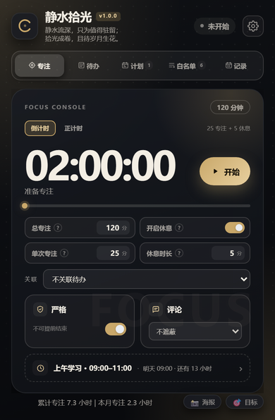
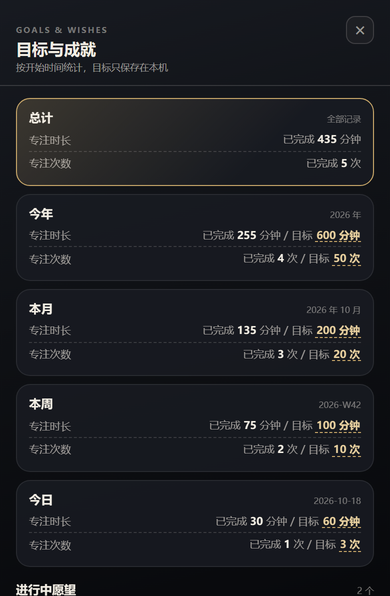
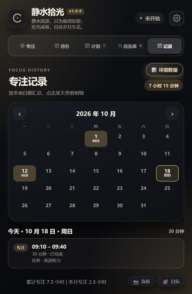
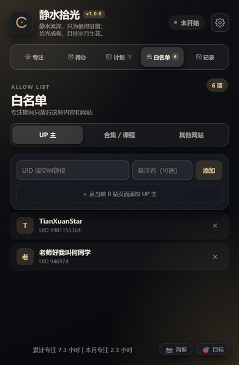
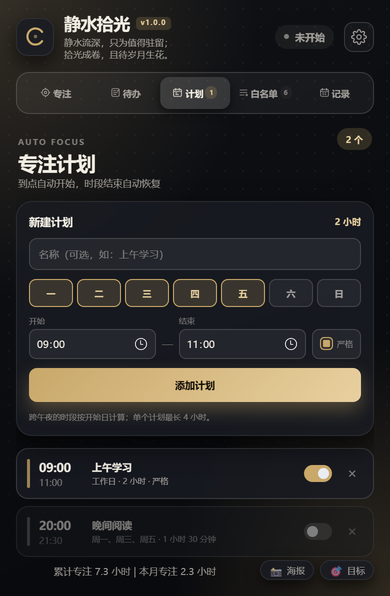
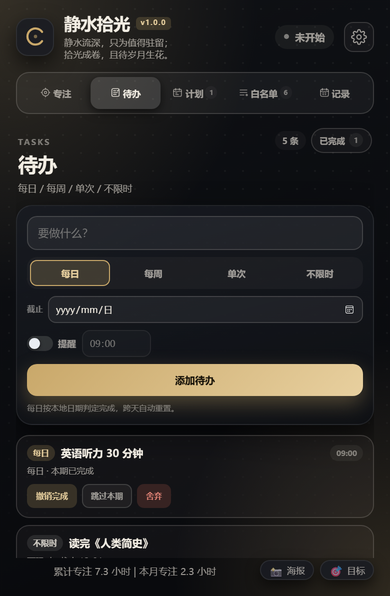
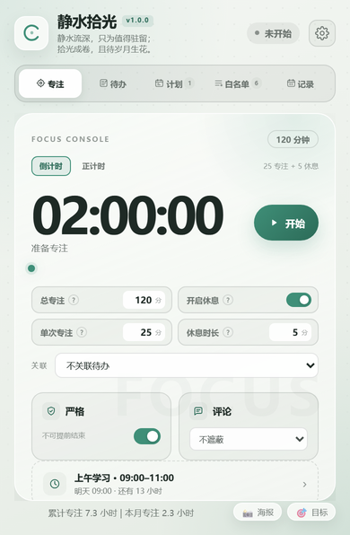
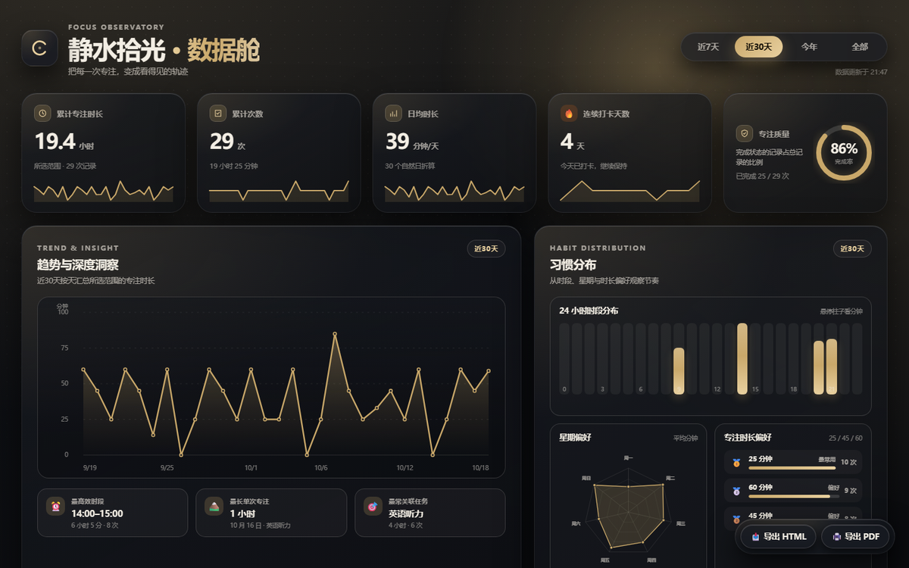

<div align="center">


# 静水拾光

**静水流深，只为值得驻留；拾光成卷，且待岁月生花。**

一款本地优先的 Chrome / Edge 专注工具：白名单、专注计时、待办、专注记录与数据看板。


</div>

---

## 这是什么

静水拾光是一个 **Manifest V3** 浏览器扩展。开始专注后，它会按你的白名单放行内容：

- B 站只放行指定的 UP 主、合集 / 系列 / 课程和单页视频；
- B 站以外的网页只放行你添加的网站；
- 其余页面会被拦截，帮你把注意力留在真正重要的事情上。

它不依赖服务器，不需要登录。白名单、计时、待办、专注记录、目标和愿望全部保存在浏览器本地。

> 它是一款自律工具，不是无法绕过的家长控制。你始终可以通过禁用或卸载扩展来结束限制。

## 界面预览

<div align="center">
  
</div>

<table>
  <tr>
    <td align="center"><br /><sub>目标与愿望</sub></td>
    <td align="center"><br /><sub>记录与热力日历</sub></td>
    <td align="center"><br /><sub>白名单</sub></td>
  </tr>
  <tr>
    <td align="center"><br /><sub>自动专注计划</sub></td>
    <td align="center"><br /><sub>待办</sub></td>
    <td align="center"><br /><sub>九套主题</sub></td>
  </tr>
</table>

<div align="center">
  
  <br />
  <sub>独立数据舱：趋势、时段分布、星期偏好、目标进度与 365 天热力图</sub>
</div>

## 功能

### 专注计时

- **倒计时 / 正计时**两种模式，随时切换。
- 支持「总专注 / 单次专注 / 休息时长」三层设置，按「专注 → 休息 → 下一段」循环。
- **严格模式**：开始后不能提前结束、不能修改白名单。
- 休息可跳过；休息结束可弹窗提醒。
- 工具栏图标显示剩余分钟数，不打开面板也能看到进度。

### 白名单

- **UP 主**：UID、空间链接，或直接添加当前 B 站页面的 UP 主。
- **合集 / 系列 / 课程**：普通视频合集、UP 主系列、`cheese` 系列课程都能整组放行。
- **单页 / 前缀**：粘贴视频链接只放行该页；链接末尾加 `*` 放行整条路径及其子路径。
- **站外网站**：按整个域名放行，自动包含子域名；也可以一键添加当前网站。
- B 站页面右键菜单可直接「将当前 UP 主 / 合集课程加入白名单」。
- B 站首页、搜索页、稍后再看等导航页面默认放行，方便你找内容。

### 自动专注计划

- 按星期和固定时段自动开始、结束专注，例如「工作日 09:00–11:00」。
- 支持跨午夜，按开始日计算；单个计划最长 4 小时。
- 每条计划可单独启用 / 暂停、单独设置严格模式。
- 浏览器中途启动时，会补上当前时段剩余的时间。
- 需要白名单里至少有一项内容，否则该次计划会跳过。

### 待办

- 每日 / 每周 / 单次 / 不限时四种类型。
- 完成、跳过本期、舍弃；每日 / 每周完成后按周期自动重置。
- 可选截止日期和提醒时间；提醒以工具栏徽标和面板内提示呈现。
- 专注开始前可以关联一条待办，专注记录里会保留任务名快照。

### 专注记录与数据舱

- 按本地日期汇总的月历，日期格按当天专注分钟数显示 4 档热力。
- 点某一天查看起止时间、时长、类型和关联任务。
- 记录页可打开独立「数据舱」：
  - 累计时长、次数、日均、连续打卡、专注质量；
  - 折线趋势、24 小时分布、七天雷达、时长偏好、Top 5；
  - 365 天热力图，点格子会自动切换范围并定位到那一天。
- 数据舱支持导出 **HTML**（离线可看）和打印成 **PDF**。

### 目标、愿望与海报

- 总计 / 今年 / 本月 / 本周 / 今日五个维度，分别设置专注时长与次数目标。
- 愿望清单：进行中愿望 → 完成还愿 → 带日期的荣誉墙。
- 一键生成 1080 × 1440 专注海报：今日 / 本月 / 今年 / 总专注四个维度。

### 外观与数据

- 9 套浅色 / 深色主题，4 种计时器样式（控制台 / 极简 / 圆环 / 数字）。
- 可关闭面板切换和悬停动效。
- 设置内支持 JSON 导出 / 导入全部本地数据。
- 所有功能离线可用，不依赖任何第三方图表库或字体。

## 安装

### 从 Release 安装（推荐）

1. 打开仓库的 **Releases** 页面，下载最新的 `静水拾光-vX.Y.Z.zip`。
2. 解压到一个固定目录（之后不要删除或移动）。
3. Chrome 打开 `chrome://extensions`，Edge 打开 `edge://extensions`。
4. 打开右上角的 **开发者模式**。
5. 点击 **加载已解压的扩展程序**，选择解压后包含 `manifest.json` 的文件夹。
6. 建议把「静水拾光」固定到浏览器工具栏。

### 从源码加载

```bash
git clone https://github.com/XuTuo-TianXuanStar/JingShuiShiGuang.git
```

然后在扩展管理页选择仓库根目录（包含 `manifest.json` 的那一层）。

### 升级

覆盖文件后，在扩展管理页点一次 **重新加载**。已有的白名单、计划、待办和专注记录会保留。

## 快速上手

1. 打开「白名单」，添加你专注时真正要用的 UP 主、课程或网站。
2. 回到「专注」，设置总专注、单次专注和休息时长。
3. 按需开启严格模式，点「开始」。
4. 专注结束后，在「记录」里查看这一天；想看得更细就点「📊 详细数据」。

### 白名单规则

| 类型 | 添加方式 | 放行范围 |
|---|---|---|
| UP 主 | UID / 空间链接 / 当前页面 | 空间页，以及能识别为该 UP 主发布的普通视频 |
| 合集 / 系列 | 合集内任一视频、系列详情页 | 该合集 / 系列中的全部视频，更新后自动识别 |
| 课程 | `cheese/play/ss...` 或任一课时页 | 整门课程；单课时链接也可只放行该课时 |
| 单页 / 路径 | 视频链接，或链接末尾加 `*` | 精确页面，或该路径及其子路径 |
| 站外网站 | 域名 / 网址 / 当前网站 | 整个域名及其子域名 |

## 数据与隐私

- 所有数据保存在 `chrome.storage.local`，不上传、不同步、不建立账号。
- 没有统计、埋点、广告或远程配置。
- 为识别 UP 主 / 合集归属，扩展会请求哔哩哔哩的公开接口；不会把白名单、浏览记录或专注数据发送给任何人。
- 导出备份时，数据只写入你本地下载的 JSON 文件。
- 主题首屏缓存写在 `localStorage`，只用于避免弹窗闪白。

### 权限说明

| 权限 | 用途 |
|---|---|
| `storage` | 保存白名单、计时、待办、记录、目标和设置 |
| `alarms` | 计时结束、休息结束、自动计划和待办提醒 |
| `tabs` | 读取当前标签页地址、打开数据舱标签页 |
| `scripting` | 右键添加白名单后的页面内提示 |
| `contextMenus` | B 站页面的「加入白名单」右键菜单 |
| `http://*/*`、`https://*/*` | 在普通网页上拦截非白名单站点，并读取 B 站页面信息 |

浏览器内部页面（如 `chrome://`、`edge://`）、扩展商店等页面不允许扩展运行，因此无法拦截。

## 已知限制

- 扩展是自律工具，用户仍可通过禁用 / 卸载扩展绕过。
- 浏览器完全关闭时，自动计划不会触发；后台大约每分钟检查一次，实际开始可能晚几十秒。
- B 站页面结构改版后，极少数识别规则可能需要更新；识别失败时会按「默认拦截」处理，避免误放行。
- 「不开启休息」且总专注超过 240 分钟时，会被单次专注上限拦截；请调小总时长或开启休息。
- 数据舱的导出 HTML 是当前页面快照，导入新数据后需要重新导出。

## 项目结构

```text
manifest.json         扩展清单（MV3）
popup.html/css/js     390 × 596 弹窗：专注 / 待办 / 计划 / 白名单 / 记录
dashboard.html/css/js 独立数据舱
content.js/css        页面守卫、拦截页、B 站评论区遮蔽
service-worker.js     计时状态机、计划、提醒、右键菜单、API 识别
shared.js             主题、清洗函数、时间与记录工具
theme-boot.js         首屏主题缓存
icons/                扩展图标与赞赏码
docs/images/          README 截图
LICENSE               CC BY-NC-SA 4.0
```

## 开发

没有构建步骤、没有运行时依赖，直接改源码后重新加载扩展即可。

```bash
node --check service-worker.js
node --check popup.js
node --check dashboard.js
node --check content.js
node --check shared.js
```

修改版本时同步更新：

1. `manifest.json` 的 `version`
2. 重新打包 Release ZIP
3. 在 Release 说明里写清变更

## 反馈

- GitHub Issues：<https://github.com/XuTuo-TianXuanStar/JingShuiShiGuang/issues>
- B 站：[@TianXuanStar](https://space.bilibili.com/1981155364)
- 邮箱：TianXuanStar@outlook.com
- 交流群：1128599418

## 许可证

本项目使用 **CC BY-NC-SA 4.0**（署名—非商业性使用—相同方式共享 4.0 国际）许可，详见 [LICENSE](LICENSE)。

你可以自由使用、修改和分享，但需要保留署名、不得用于商业用途，并以相同许可分享衍生作品。如需商业授权，请通过上面的邮箱联系作者。

---

<div align="center">
  <sub>静水拾光 · 与哔哩哔哩官方无关 · 仅供个人自律使用</sub>
</div>
